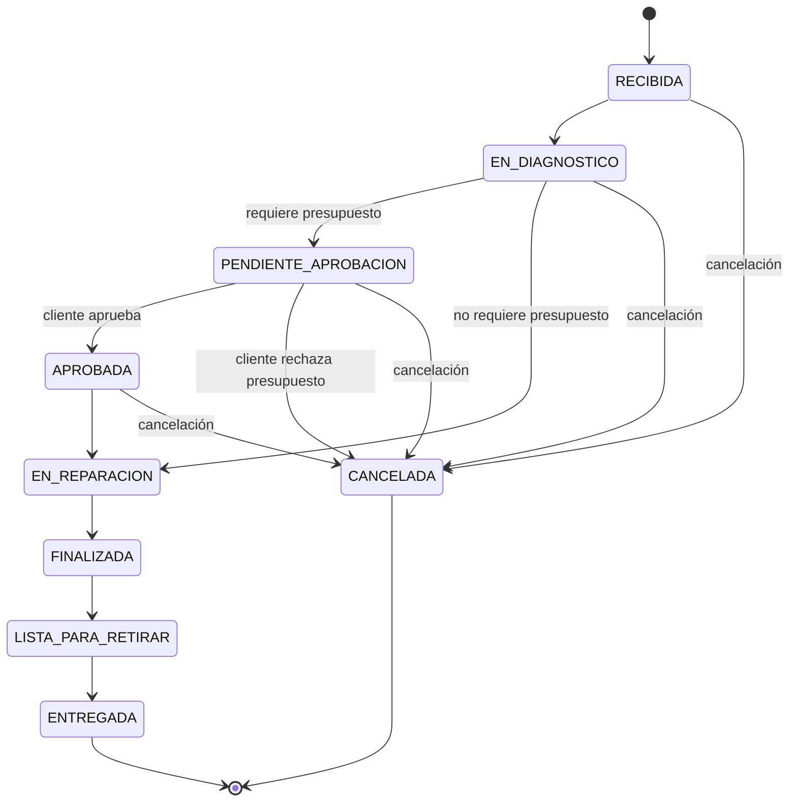

# FixHub

Sistema Integral de Gestión para Talleres y Servicios Técnicos.

## Descripción

FixHub es una aplicación web orientada a talleres y servicios técnicos pequeños y medianos que busca centralizar y organizar el ciclo completo de una reparación, desde la recepción del equipo hasta su entrega al cliente.

La propuesta surge a partir de una problemática real observada en un servicio técnico, donde diferentes procesos de gestión se realizan mediante herramientas y canales no integrados, como planillas de cálculo, WhatsApp, llamadas telefónicas y registros manuales.

A partir de esta situación, el equipo realizó relevamientos adicionales en otros talleres, que arrojaron resultados similares. Esto permitió reconocer una problemática común a distintos servicios técnicos, como reparación de celulares, electrónica, computación, electrodomésticos y otros rubros.

## Objetivo

Desarrollar el MVP de FixHub, un Sistema Integral de Gestión para Talleres y Servicios Técnicos que permita administrar el ciclo completo de reparaciones, centralizando la información y automatizando tareas manuales.

## Requerimientos funcionales

FixHub deberá permitir:

- Autenticar a los usuarios y controlar el acceso a las funcionalidades según los roles y permisos asignados.
- Administrar usuarios y roles del sistema de acuerdo con los permisos asignados.
- Registrar, editar y consultar clientes.
- Permitir al Recepcionista crear de forma controlada una cuenta de acceso con rol Cliente durante el registro de un cliente que todavía no posea una.
- Reutilizar la cuenta de acceso existente cuando un cliente ya registrado incorpore nuevos equipos u órdenes de trabajo.
- Vincular cada Cliente con una única cuenta de acceso para limitar el acceso a su propia información, equipos, órdenes y presupuestos.
- Permitir que el cliente utilice su correo electrónico o número de celular como identificador de acceso.
- Permitir el primer ingreso mediante una credencial temporal que posteriormente deberá ser reemplazada por una contraseña definida por el cliente.
- Permitir al cliente autenticado acceder únicamente a las funcionalidades y a la información correspondientes a su propio registro.
- Registrar y consultar los equipos asociados a cada cliente.
- Crear órdenes de trabajo vinculadas a un cliente y a un equipo.
- Registrar el problema informado al momento de recibir el equipo.
- Asignar un técnico responsable a cada orden de trabajo.
- Registrar y actualizar el diagnóstico correspondiente a una reparación.
- Registrar tareas y observaciones técnicas realizadas durante el proceso.
- Gestionar los estados de las órdenes de trabajo durante todo el ciclo de reparación.
- Generar presupuestos que incluyan mano de obra y repuestos.
- Permitir que el cliente consulte, apruebe o rechace sus propios presupuestos.
- Impedir el inicio de una reparación cuando exista un presupuesto requerido que todavía no haya sido aprobado.
- Registrar y consultar repuestos disponibles.
- Mantener actualizado el stock a partir de entradas, ajustes y consumos reales.
- Registrar los movimientos necesarios para conservar la trazabilidad de las variaciones de stock.
- Mantener un historial de los cambios relevantes realizados sobre las órdenes de trabajo.
- Permitir consultar las reparaciones anteriores asociadas a un cliente o a un equipo.
- Permitir que el cliente consulte el estado y la información habilitada de sus propias reparaciones.
- Mostrar indicadores básicos de gestión utilizando información de las órdenes de trabajo y del inventario.
- Proporcionar una interfaz web adaptable a distintos tamaños de pantalla.

## Reglas de negocio

Las siguientes reglas definen el comportamiento esperado del sistema dentro del alcance del MVP y deberán respetarse durante la implementación.

### Usuarios, roles y acceso de clientes

Las decisiones del proyecto se registran en el [historial del TFI](docs/entregas/historial.md).

- Los roles internos Administrador, Recepcionista y Técnico podrán combinarse libremente en una cuenta y sus permisos se acumularán.
- Cada Cliente deberá tener asociada una única cuenta de acceso.
- Si durante el registro de un cliente todavía no existe una cuenta asociada, el Recepcionista deberá crear una cuenta únicamente con rol Cliente.
- Si el cliente ya posee una cuenta de acceso, deberá reutilizarse para sus futuros equipos y órdenes de trabajo.
- La cuenta con rol Cliente quedará vinculada exclusivamente a un único registro de Cliente para determinar qué información, equipos, órdenes y presupuestos puede consultar.
- Cliente será un rol exclusivo: no podrá combinarse con roles internos. Su cuenta no podrá representar a más de un Cliente.
- El cliente deberá disponer de al menos un medio de contacto válido: correo electrónico o número de celular.
- El correo electrónico o el número de celular podrán utilizarse como identificador de acceso.
- El primer ingreso se realizará mediante una credencial temporal que deberá ser reemplazada por una contraseña definida por el cliente.
- El número de orden de trabajo no podrá utilizarse como contraseña.
- Las contraseñas deberán tener entre 8 y 72 caracteres y no podrán estar compuestas exclusivamente por dígitos. Al cambiar la contraseña, la nueva deberá ser diferente de la actual.
- No se permitirá el registro público y autónomo de usuarios dentro del MVP.
- El rol Recepcionista, por sí solo, no habilita la creación de usuarios con roles internos ni la administración de roles; estas acciones requieren el rol Administrador.
- La integración automática con WhatsApp Business continuará fuera del alcance del MVP.

### Clientes, equipos y órdenes de trabajo

- Toda orden de trabajo deberá estar asociada a un cliente y a un equipo.
- Cada equipo estará asociado a un único cliente, mientras que un cliente podrá tener uno o varios equipos.
- Cada orden de trabajo tendrá un único técnico responsable. La participación de múltiples técnicos en una misma orden queda fuera del alcance del MVP.
- Una orden podrá crearse inicialmente sin técnico responsable mientras permanezca en estado `RECIBIDA`, pero deberá tener uno asignado antes de pasar a `EN_DIAGNOSTICO`.
- El Técnico solamente podrá realizar acciones técnicas sobre las órdenes que tenga asignadas.
- Cada orden podrá tener como máximo un diagnóstico.
- El diagnóstico podrá modificarse cuando corresponda, pero no se manejarán versiones independientes dentro del MVP.
- Los cambios relevantes realizados sobre una orden deberán conservarse para mantener su trazabilidad.
- La cancelación normal de una orden solamente estará permitida antes de iniciar la reparación.
- Las órdenes en estado `ENTREGADA` o `CANCELADA` se considerarán finalizadas dentro del flujo del MVP.

### Presupuestos

- Cada orden que requiera presupuesto podrá tener como máximo un presupuesto.
- El presupuesto podrá modificarse mientras se encuentre pendiente de la decisión del cliente.
- Una vez aprobado o rechazado, el presupuesto quedará cerrado y no se manejarán versiones independientes dentro del MVP.
- El total del presupuesto se calculará a partir de la mano de obra y de los repuestos incluidos.
- Solamente el cliente correspondiente podrá aprobar o rechazar su propio presupuesto.
- Si una reparación requiere presupuesto, no podrá iniciarse hasta que el cliente lo haya aprobado.
- Si el cliente rechaza un presupuesto requerido, la orden no continuará hacia reparación y pasará a estado `CANCELADA`.
- Los repuestos incluidos en un presupuesto representan una estimación y no modificarán el stock real.
- Los repuestos presupuestados y los repuestos realmente consumidos se registrarán como conceptos diferentes.

### Inventario y stock

- El stock se representará como un atributo de `Repuesto`; no se utilizará una entidad `Stock` independiente dentro del MVP.
- Las variaciones de existencias deberán conservar su trazabilidad mediante movimientos de stock.
- El consumo real de un repuesto disminuirá las existencias y deberá registrarse de manera consistente con el movimiento correspondiente.
- No se permitirá registrar un consumo que genere existencias negativas.
- El registro de consumos reales corresponderá al rol Técnico sobre sus órdenes asignadas.
- Un usuario con rol Administrador solamente podrá registrar consumos si también posee el rol Técnico y tiene asignada la orden correspondiente.
- El Administrador podrá registrar repuestos, entradas y ajustes de stock.
- El rol Recepcionista, por sí solo, permite consultar la disponibilidad de repuestos, pero no modificar las existencias. Las entradas y ajustes requieren Administrador; los consumos requieren Técnico y una orden asignada.
- Incluir un repuesto en un presupuesto no se considerará un consumo y no modificará el stock real.

## Módulos funcionales

Para organizar las responsabilidades principales del sistema, FixHub se divide en cinco módulos funcionales:

1. Autenticación, usuarios y roles.
2. Clientes y equipos.
3. Órdenes de trabajo.
4. Presupuestos y aprobación.
5. Inventario y stock.

El diagnóstico, el historial y la trazabilidad, el seguimiento del cliente y el dashboard se integran dentro de estos módulos o funcionan de manera transversal, por lo que no se consideran módulos independientes.

La definición detallada de responsabilidades, dependencias, reglas y permisos se encuentra en la [Definición de módulos de la Segunda Entrega](docs/entregas/entrega_02/modulos.md).

## Roles y permisos

FixHub contempla cuatro roles principales dentro del MVP: Administrador, Recepcionista, Técnico y Cliente.

Una cuenta podrá combinar los roles internos Administrador, Recepcionista y Técnico, acumulando sus permisos. Cliente será exclusivo y no podrá combinarse con esos roles.

Las atribuciones y restricciones siguientes corresponden a cada rol interno por separado. Una cuenta multirrol acumula las acciones habilitadas por sus roles, sin omitir las condiciones de estado, propiedad de los datos o asignación de la orden.

### Administrador

El Administrador será responsable de la gestión general del sistema. Podrá:

- Administrar usuarios, roles y permisos.
- Crear y gestionar cuentas con roles Administrador, Recepcionista y Técnico.
- Registrar, editar y consultar clientes y equipos.
- Crear órdenes de trabajo, administrar sus datos de recepción y asignar técnicos.
- Consultar todas las órdenes de trabajo.
- Crear, editar y publicar presupuestos, pero no aprobarlos ni rechazarlos en nombre del cliente.
- Registrar, editar y consultar repuestos.
- Gestionar entradas y ajustes de stock.
- Consultar información general e indicadores del sistema.
- Cancelar órdenes cuando las reglas de negocio lo permitan.

Las tareas estrictamente técnicas de diagnóstico, reparación y consumo real de repuestos estarán reservadas al rol Técnico. Un usuario con rol Administrador solamente podrá realizarlas si también posee el rol Técnico y tiene asignada la orden correspondiente.

### Recepcionista

El Recepcionista estará orientado principalmente a la atención del cliente y a la gestión administrativa del proceso de recepción y entrega. Podrá:

- Registrar, editar y consultar clientes y equipos.
- Crear una cuenta de acceso únicamente con rol Cliente cuando registre a un cliente que todavía no posea una, o reutilizar la existente.
- Crear órdenes de trabajo y registrar la información de recepción.
- Asignar o cambiar el técnico responsable.
- Consultar las órdenes de trabajo.
- Crear, editar y publicar presupuestos mientras se encuentren pendientes de la decisión del cliente.
- Consultar el catálogo de repuestos y su disponibilidad.
- Marcar órdenes como listas para retirar.
- Registrar la entrega del equipo.
- Consultar los indicadores operativos que tenga habilitados.

El rol Recepcionista, por sí solo, no habilita la administración de roles ni la creación de cuentas internas; estas acciones requieren Administrador. Una cuenta que además posea Técnico podrá realizar diagnósticos, reparaciones y consumos sobre sus órdenes asignadas, respetando los estados permitidos. Las entradas y ajustes de stock requieren Administrador. Ningún rol interno habilita la aprobación o el rechazo de presupuestos en nombre del Cliente.

### Técnico

El Técnico será responsable de las acciones directamente relacionadas con la reparación. Podrá:

- Consultar las órdenes que tenga asignadas.
- Consultar la información necesaria del cliente y del equipo vinculados con esas órdenes.
- Registrar y actualizar el diagnóstico.
- Registrar tareas y observaciones técnicas.
- Iniciar y finalizar la reparación.
- Participar en la elaboración de presupuestos correspondientes a sus órdenes asignadas.
- Consultar repuestos.
- Registrar los consumos reales de repuestos utilizados durante la reparación.

El rol Técnico, por sí solo, no habilita la administración de clientes, equipos, usuarios, roles ni existencias generales del inventario. Una cuenta que además posea Recepcionista o Administrador podrá gestionar clientes y equipos. Recepcionista permite crear cuentas CLIENTE de forma controlada durante el registro de clientes, conforme a las reglas existentes; la administración de cuentas internas y roles y las entradas y ajustes de stock requieren Administrador.

### Cliente

El Cliente accederá al sistema mediante la cuenta vinculada exclusivamente a su registro. Podrá:

- Iniciar sesión utilizando su cuenta de acceso.
- Consultar únicamente sus propios datos y equipos.
- Consultar el estado y la información habilitada de sus propias reparaciones.
- Consultar sus diagnósticos cuando se encuentren disponibles.
- Consultar sus propios presupuestos.
- Aprobar o rechazar únicamente sus propios presupuestos.
- Consultar su historial de reparaciones cuando corresponda.

El Cliente no podrá acceder a información perteneciente a otros clientes, observaciones internas ni realizar funciones administrativas, técnicas o de inventario.

## Flujo de las órdenes de trabajo

El ciclo de una orden de trabajo representa el proceso de una reparación desde la recepción del equipo hasta su entrega al cliente o su cancelación.

Los estados definidos para el MVP son:

- `RECIBIDA`
- `EN_DIAGNOSTICO`
- `PENDIENTE_APROBACION`
- `APROBADA`
- `EN_REPARACION`
- `FINALIZADA`
- `LISTA_PARA_RETIRAR`
- `ENTREGADA`
- `CANCELADA`

La asignación de un técnico responsable no se considera un estado de la orden. Una orden podrá crearse sin técnico mientras permanezca en `RECIBIDA`, pero deberá tener uno asignado antes de pasar a `EN_DIAGNOSTICO`.

La asignación o cambio del técnico responsable deberá quedar registrada para conservar la trazabilidad de la orden.

Los estados propios del presupuesto se gestionarán de manera independiente y no se duplicarán como estados de la orden de trabajo.

### Diagrama de estados

El siguiente diagrama representa las transiciones definidas para el ciclo de vida de una orden de trabajo dentro del alcance del MVP.



### Flujo sin presupuesto

Cuando la reparación no requiere aprobación previa mediante presupuesto, el flujo será:

`RECIBIDA → EN_DIAGNOSTICO → EN_REPARACION → FINALIZADA → LISTA_PARA_RETIRAR → ENTREGADA`

### Flujo con presupuesto

Cuando la reparación requiere la aprobación previa de un presupuesto, el flujo será:

`RECIBIDA → EN_DIAGNOSTICO → PENDIENTE_APROBACION → APROBADA → EN_REPARACION → FINALIZADA → LISTA_PARA_RETIRAR → ENTREGADA`

Mientras la orden se encuentre en `PENDIENTE_APROBACION`, la reparación no podrá iniciarse.

Si el cliente aprueba el presupuesto, la orden pasará a `APROBADA` y podrá continuar hacia `EN_REPARACION`.

Si el cliente rechaza un presupuesto requerido, la orden pasará a `CANCELADA` y no continuará hacia reparación.

### Transiciones permitidas

Las transiciones normales serán:

- `RECIBIDA → EN_DIAGNOSTICO`
- `EN_DIAGNOSTICO → PENDIENTE_APROBACION`, cuando se requiera presupuesto.
- `EN_DIAGNOSTICO → EN_REPARACION`, cuando no se requiera presupuesto.
- `PENDIENTE_APROBACION → APROBADA`, cuando el cliente apruebe el presupuesto.
- `PENDIENTE_APROBACION → CANCELADA`, cuando el cliente rechace el presupuesto.
- `APROBADA → EN_REPARACION`
- `EN_REPARACION → FINALIZADA`
- `FINALIZADA → LISTA_PARA_RETIRAR`
- `LISTA_PARA_RETIRAR → ENTREGADA`

La cancelación también podrá realizarse desde:

- `RECIBIDA → CANCELADA`
- `EN_DIAGNOSTICO → CANCELADA`
- `PENDIENTE_APROBACION → CANCELADA`
- `APROBADA → CANCELADA`

Una vez iniciada la reparación no se contemplará una cancelación normal dentro del MVP.

Toda cancelación deberá conservar la información necesaria para su trazabilidad, incluyendo el usuario responsable, la fecha y el motivo.

Los estados `ENTREGADA` y `CANCELADA` se consideran estados finales.

## Tecnologías

### Frontend

- HTML
- CSS
- JavaScript
- TypeScript
- Vite

### Backend

- Java 25
- Spring Boot 4.1.1
- Maven Wrapper (Maven 3.9.16)
- Spring Web MVC
- Spring Data JPA
- Hibernate
- Spring Security
- JWT
- API REST

### Base de datos

- MySQL

### Control de versiones

- Git
- GitHub

## Diseño de base de datos

FixHub utiliza un modelo relacional con MySQL. Para la Segunda Entrega se documentaron el diagrama DER, el diccionario de datos y la justificación de las decisiones de modelado.

La documentación completa se encuentra en [Diseño de la base de datos](docs/entregas/entrega_02/base_de_datos/bases_datos.md).

## Despliegue

- **Frontend:** publicado en [https://fixhub-five.vercel.app](https://fixhub-five.vercel.app) mediante Vercel, integrado con GitHub y con despliegues de producción desde `main`.
- **Backend:** publicado en [https://fixhub-backend.onrender.com](https://fixhub-backend.onrender.com) mediante Render y el contenedor Docker del repositorio.
- **Base de datos:** MySQL 8.4.13 alojado en Railway, conectado al backend mediante TLS con `VERIFY_CA`.

El frontend consume la API pública del backend desplegado en Render.

## Alcance

El MVP está orientado a talleres y servicios técnicos pequeños o medianos y busca resolver principalmente la gestión operativa de reparaciones.

Quedan fuera del alcance inicial:

- Pagos online.
- Facturación electrónica AFIP/ARCA.
- Integración con WhatsApp Business.
- Aplicación móvil nativa.
- Geolocalización.
- Inteligencia artificial.
- Gestión de múltiples sucursales.
- Contabilidad completa.
- Compras automáticas a proveedores.
- Marketplace de repuestos.

## Integrantes

**Grupo 186**

- Damián Nogueira
- Gabriel Etchegoyen
- Manuel Galarza

## Tutor

- Sofía Raia

## Estado del proyecto

La Segunda Entrega de diseño y documentación se encuentra completada y el MVP está implementado. El frontend está desplegado en Vercel, el backend en Render y la base de datos MySQL funciona en Railway. Continúan las validaciones y las tareas de cierre documental. El sistema cuenta con:

- Autenticación JWT, gestión de usuarios y roles, cambio obligatorio de clave y respuestas de error 401/403.
- Gestión de clientes y equipos, creación o reutilización de cuentas Cliente y consultas de información propia.
- Órdenes de trabajo con asignación y cambio de técnico, estados, cancelación y acceso según rol y propiedad.
- Diagnóstico único por orden, registros técnicos y consultas de historial y reparaciones por cliente o equipo.
- Presupuestos con creación, edición, publicación y decisión del Cliente, integrados con el flujo de la orden.
- Catálogo de repuestos, entradas, ajustes, consumos reales y movimientos de stock.
- Frontend con vistas de gestión, portal del Cliente y navegación según roles.
- Dashboard básico calculado a partir de órdenes y repuestos.

## Instalación y ejecución

### Requisitos

- Java 25 y Maven Wrapper incluido en el repositorio.
- MySQL 8.0.16 o superior, para aplicar las restricciones `CHECK` del esquema.
- Node.js y npm para el frontend. Vite requiere Node `^20.19.0 || >=22.12.0`.
- Docker, únicamente para construir y ejecutar el contenedor del backend.

### Inicialización de MySQL

El backend utiliza `spring.jpa.hibernate.ddl-auto=none`: Hibernate no crea ni actualiza las tablas. El esquema de 15 tablas está preparado en los siguientes scripts, que deben ejecutarse una sola vez y en este orden sobre una base vacía:

1. [base.sql](docs/sql/base.sql): usuarios, roles, clientes, equipos, órdenes, diagnóstico, registros técnicos, historial y repuestos.
2. [presupuestos.sql](docs/sql/presupuestos.sql): presupuestos y sus detalles.
3. [inventario.sql](docs/sql/inventario.sql): consumos de repuestos y movimientos de stock.

Crear previamente una base con codificación `utf8mb4` y revisar su collation. Los scripts utilizan InnoDB y heredan la codificación y collation de esa base; no crean usuarios ni credenciales.

Desde el cliente `mysql`, conectado a la base vacía y con la raíz del repositorio como directorio de trabajo:

```sql
SOURCE docs/sql/base.sql;
SOURCE docs/sql/presupuestos.sql;
SOURCE docs/sql/inventario.sql;
```

En otras herramientas, ejecutar el contenido de los archivos en el mismo orden. Detenerse ante errores. Estos scripts no son migraciones y no deben ejecutarse sobre tablas existentes.

Los inicializadores crean los roles y estados faltantes sobre el esquema ya preparado. El administrador inicial es opcional y requiere habilitar su bootstrap y configurar sus credenciales. Para una base nueva, mantener habilitada la inicialización de roles antes de crear el administrador.

### Variables de entorno

Configurar las variables del backend en el entorno del proceso:

| Variable | Uso |
| --- | --- |
| `DB_URL` | URL JDBC de MySQL; su formato depende de la ejecución Java directa o Docker, como se detalla debajo |
| `DB_USERNAME` | Usuario de la base |
| `DB_PASSWORD` | Contraseña de la base |
| `JWT_SECRET` | Clave Base64 que represente al menos 32 bytes |
| `PORT` | Opcional; puerto HTTP, predeterminado 8080 |
| `JWT_EXPIRATION` | Opcional; duración del token, predeterminada `PT1H` |
| `BOOTSTRAP_ROLES_ENABLED` | Opcional; predeterminado `true` |
| `BOOTSTRAP_ADMIN_ENABLED` | Opcional; predeterminado `false` |
| `BOOTSTRAP_ADMIN_EMAIL` | Necesario si se habilita el administrador inicial |
| `BOOTSTRAP_ADMIN_PASSWORD` | Necesario si se habilita el administrador inicial |

La propiedad `app.bootstrap.estados-orden.enabled` controla la inicialización de estados y está habilitada de forma predeterminada. Después de crear el administrador inicial, deshabilitar su bootstrap antes de retirar sus credenciales. Mantener `JWT_SECRET` estable entre reinicios.

Las plantillas [backend/.env.example](backend/.env.example) y [frontend/.env.example](frontend/.env.example) enumeran las variables sin credenciales reales. Completar los valores en el entorno local o del proveedor. Spring Boot no carga automáticamente archivos `.env`: para el backend deben exportarse las variables al proceso. No versionar secretos ni incluirlos en la imagen Docker.

Generar `JWT_SECRET` de forma privada como al menos 32 bytes aleatorios codificados en Base64. Los valores vacíos de la plantilla deben completarse antes de iniciar el backend; no representan credenciales disponibles.

### Backend

Después de preparar MySQL y las variables, ejecutar desde `backend`:

En esta ejecución Java directa se utiliza `DB_URL` tal como se suministra; no se ejecuta `docker-entrypoint.sh` ni se genera un truststore. Un ejemplo local sin credenciales es `jdbc:mysql://localhost:3306/fixhub`. Para una conexión remota deben configurarse los parámetros TLS y el truststore requeridos por el proveedor, sin desactivar la verificación de certificados.

Windows PowerShell:

```powershell
.\mvnw.cmd spring-boot:run
```

macOS y Linux:

```bash
./mvnw spring-boot:run
```

El servidor escucha en `0.0.0.0` y utiliza `PORT`, o 8080 si no se define. CORS permite el frontend publicado en Vercel y los orígenes locales `http://localhost:5173` y `http://127.0.0.1:5173`.

### Frontend

El frontend utiliza TypeScript y Vite, con páginas, componentes y servicios propios y navegación mediante fragmentos `#`. La autorización se aplica en el backend.

Desde `frontend`:

```bash
npm ci
npm run dev
```

La variable pública `VITE_API_BASE_URL` configura la dirección de la API, incluyendo `/api` y sin barra final. Su valor predeterminado es `http://localhost:8080/api`. No debe contener secretos. Para producción se incorpora durante el build; cambiarla requiere reconstruir el frontend.

Para desarrollo puede copiarse `frontend/.env.example` a `frontend/.env.local`, que Vite carga automáticamente. En Vercel, el valor de producción es `https://fixhub-backend.onrender.com/api`.

```bash
npm run build
npm run preview
```

El build ejecuta TypeScript y Vite y genera `frontend/dist`, directorio de salida utilizado en Vercel. No hay scripts de lint ni tests de frontend configurados.

### Contenedor del backend

El [Dockerfile](backend/Dockerfile) multi-stage compila con Maven Wrapper y Java 25, ejecuta `verify` y utiliza un JRE 25 con usuario sin privilegios. [.dockerignore](backend/.dockerignore) excluye artefactos locales y configuraciones sensibles.

En esta ejecución, `DB_URL` debe contener únicamente servidor, puerto y base, por ejemplo `jdbc:mysql://servidor-mysql:3306/railway`, sin parámetros, fragmentos ni credenciales. `DB_USERNAME` y `DB_PASSWORD` se suministran por separado.

El arranque exige el certificado CA público del servidor MySQL en `/etc/secrets/railway-ca.pem`. Crea un truststore PKCS12 temporal y agrega los parámetros JDBC de `VERIFY_CA`; no modifica el almacén general de certificados de Java. Si falta el certificado o no puede leerse, el contenedor no inicia.

Desde la raíz del repositorio, con Docker disponible y las variables exportadas al entorno:

```bash
docker build -t fixhub-backend:local backend
docker run --rm -p 10000:10000 -e PORT=10000 -e DB_URL -e DB_USERNAME -e DB_PASSWORD -e JWT_SECRET --mount "type=bind,source=RUTA_ABSOLUTA_DEL_CA,target=/etc/secrets/railway-ca.pem,readonly" fixhub-backend:local
```

Reemplazar `RUTA_ABSOLUTA_DEL_CA` por la ruta absoluta del archivo CA público en el equipo. El archivo debe ser legible por el usuario sin privilegios del contenedor. No incorporar certificados ni secretos al repositorio. Las variables reenviadas deben apuntar a una base con el esquema preparado. El host MySQL debe ser accesible desde el contenedor; `localhost` dentro del contenedor no representa al equipo anfitrión.

En Render se utiliza el contexto Docker `backend/`, se configuran las variables del backend y se monta el Secret File `railway-ca.pem` en `/etc/secrets/railway-ca.pem`. La imagen contempla el grupo 1000 para su lectura. Render proporciona `PORT`; no es necesario fijarlo a 8080. La configuración CORS conserva el origen del frontend publicado. No ejecutar los scripts SQL de instalación sobre la base productiva existente.

### Acceso de evaluación y usuarios de prueba

El equipo debe proporcionar por un canal privado las cuentas de evaluación autorizadas, sus roles y los datos ficticios habilitados para la demostración. No se publican credenciales administrativas ni se presupone que las cuentas ilustrativas de Postman existan. Quedan por confirmar los identificadores, el medio de entrega de las claves y las órdenes asignadas a cada Técnico de prueba.

| Rol | Recorrido de evaluación |
| --- | --- |
| Administrador | Consultar usuarios, clientes, órdenes, presupuestos, catálogo y movimientos; realizar modificaciones únicamente sobre registros de demostración autorizados |
| Recepcionista | Registrar clientes y equipos, gestionar recepción y entrega, asignar técnicos y publicar presupuestos |
| Técnico | Trabajar sobre sus órdenes asignadas: diagnóstico, tareas, reparación y consumos |
| Cliente | Consultar exclusivamente sus datos, equipos, órdenes y presupuestos; aprobar o rechazar los propios |

Las cuentas internas pueden combinar roles y acumular permisos; Cliente es exclusivo. Si la cuenta exige cambiar la clave temporal, realizar el cambio y volver a iniciar sesión para obtener un JWT actualizado. No se presupone la existencia de un entorno de pruebas aislado: toda operación que modifique datos debe limitarse a registros de demostración expresamente autorizados por el equipo. No crear ni modificar cuentas ni otros registros productivos como parte de una prueba sin autorización.

### Colección Postman

Importar la [colección](docs/postman/FixHub.postman_collection.json) y el [entorno local](docs/postman/FixHub.postman_environment.json). Las variables están definidas en el entorno: configurar `baseUrl` sin `/api` ni barra final, `identificador` y `clave` privados, y ejecutar Login. El script guarda el token Bearer y `usuarioAutenticadoId`; `usuarioId` identifica por separado el usuario objetivo de una operación administrativa.

Completar los IDs de recursos con registros ficticios de demostración autorizados por el equipo; los valores vacíos no son IDs válidos. Cambiar la sesión según los permisos indicados en cada grupo. Para reutilizar una cuenta como Cliente, `usuarioId` debe corresponder a CLIENTE exclusivo y no estar vinculado a otro Cliente. Cambiar la clave exige actualizar `clave` en el entorno y repetir Login.

La colección incluye consultas y operaciones que alteran datos, roles, contraseñas, estados, presupuestos y stock. No ejecutarla completa mediante Runner contra producción. Elegir cada solicitud conscientemente sobre una base aislada: cancelación, decisiones de presupuesto, desactivación, retiro de roles y movimientos de stock tienen efectos persistentes. Aprobar y rechazar son alternativas, no pasos consecutivos sobre el mismo presupuesto. Los precios y contactos de los ejemplos son ficticios; no acreditan cuentas disponibles ni pruebas ejecutadas.

## Compilación y pruebas

Desde `backend`, en Windows PowerShell:

```powershell
.\mvnw.cmd test
.\mvnw.cmd verify
```

En macOS y Linux:

```bash
./mvnw test
./mvnw verify
```

`test` ejecuta las pruebas y `verify` también compila y empaqueta el JAR ejecutable en `backend/target/backend-0.0.1-SNAPSHOT.jar`.

Las pruebas del backend abarcan seguridad, controllers, servicios, repositories y transacciones, y utilizan H2 en memoria en modo MySQL cuando requieren persistencia. No sustituyen la validación integral contra MySQL ni las pruebas de integración del sistema desplegado.

## Trabajo Final Integrador

Proyecto desarrollado como Trabajo Final Integrador de la Tecnicatura Universitaria en Programación a Distancia.
