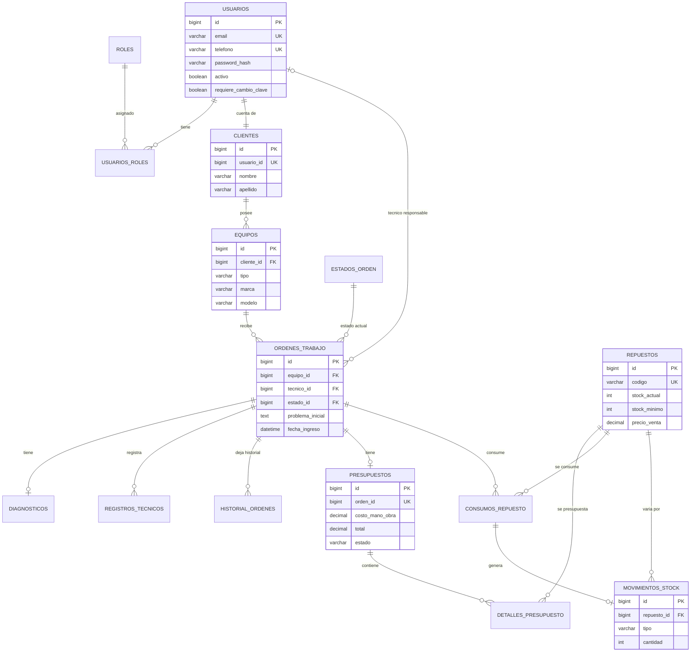
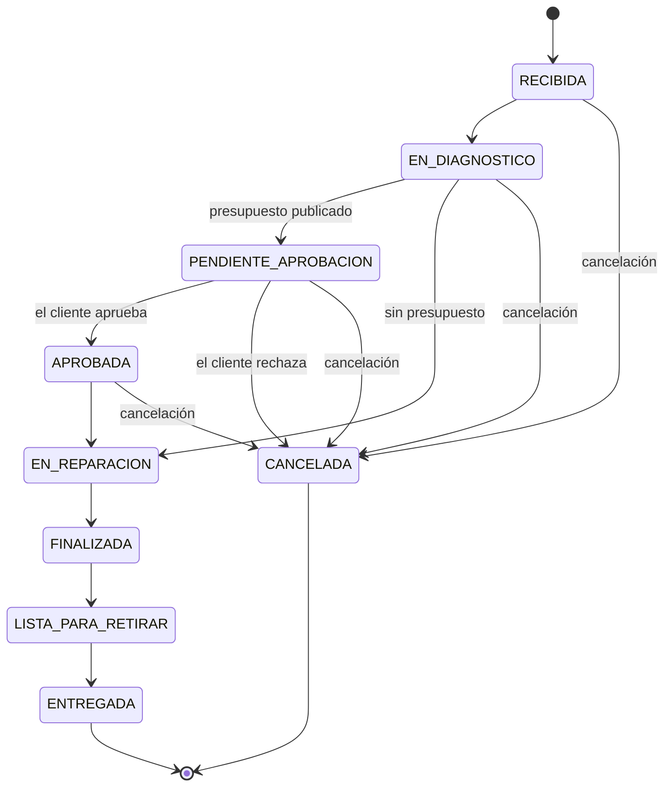
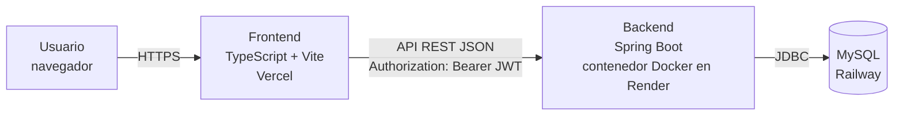
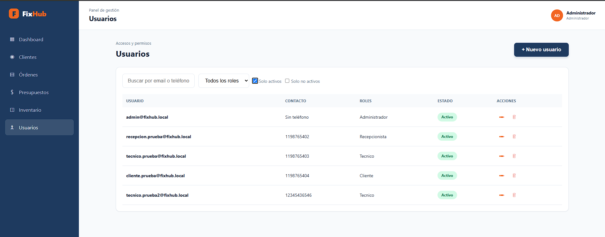
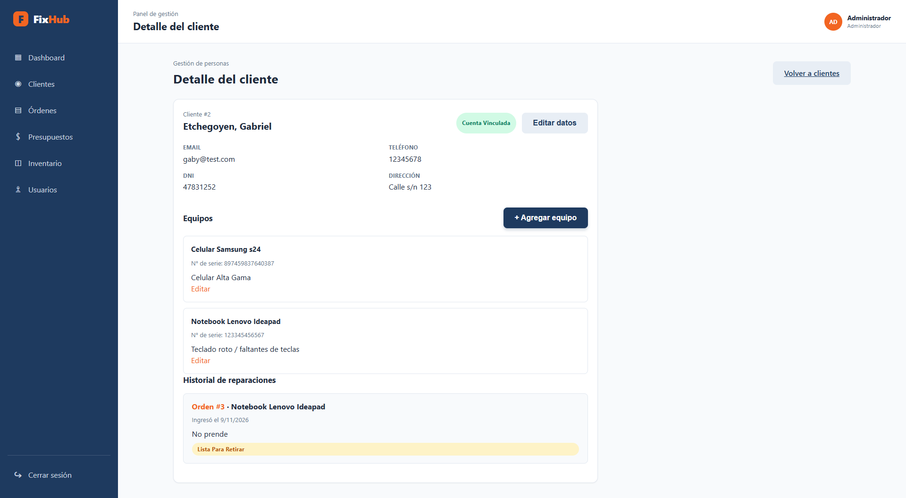
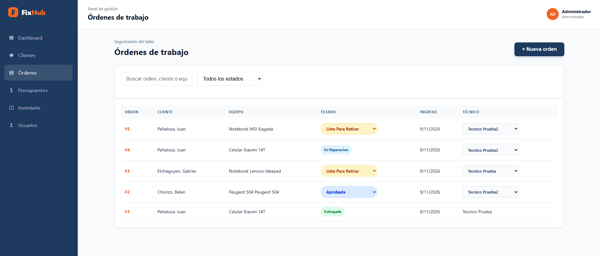
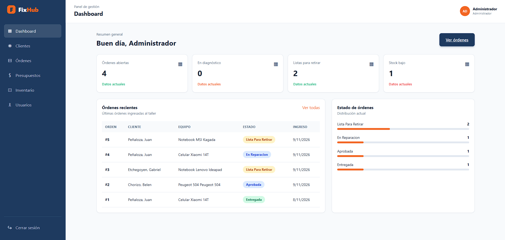
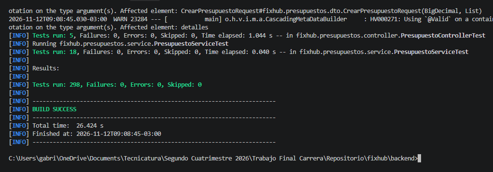

<div align="center">


# FixHub

**Sistema Integral de Gestión para Talleres y Servicios Técnicos**

Informe Final del Trabajo Final Integrador

</div>

| | |
|---|---|
| **Universidad** | Universidad Tecnologica Nacional |
| **Carrera** | Tecnicatura Universitaria en Programación a Distancia |
| **Materia** | Proyecto Final (Trabajo Final de la carrera) |
| **Proyecto** | FixHub |
| **Grupo** | 186 |
| **Integrantes** | Damián Nogueira, Gabriel Etchegoyen, Manuel Galarza|
| **Tutora** | Sofía Raia |
| **Año** | 2026 |

---

## 1. Problema y contexto

### 1.1 Situación que originó el proyecto

FixHub nació de una problemática observada en un servicio técnico real: los distintos procesos de una reparación se gestionaban con herramientas que no estaban integradas entre sí, como planillas de cálculo, mensajes de WhatsApp, llamadas telefónicas y registros manuales. En ese esquema, el estado de un equipo, el diagnóstico, el presupuesto acordado con el cliente y los repuestos utilizados viven en lugares distintos, lo que dificulta saber en qué etapa está cada reparación, qué se acordó con el cliente y cuánto stock queda realmente.

El equipo consideró que esta situación no es exclusiva de ese taller, sino que puede repetirse en otros servicios técnicos pequeños y medianos, como los dedicados a celulares, electrónica, computación o electrodomésticos. A partir de eso se definió el sistema como una herramienta genérica para ese tipo de negocios.

Antes de FixHub, el grupo había presentado otra propuesta (MyPapyro), que el comité no aprobó para continuar. Tras esa devolución se presentó FixHub como nueva propuesta, que la tutora aprobó sin observaciones adicionales. La Segunda Entrega documentó los módulos funcionales, los requerimientos, las reglas de negocio, los roles, el flujo de las órdenes y el diseño de la base de datos. El seguimiento de estos cambios está en [docs/entregas/historial.md](entregas/historial.md).

El servicio técnico observado es un taller **electromecánico automotriz**, en el que uno de los integrantes del equipo desarrolla su actividad y desde donde planteó la problemática. Según la Primera Entrega, en ese taller la comunicación con los clientes se resolvía por WhatsApp, por llamadas telefónicas o de forma presencial, y otros controles internos, como el stock de repuestos, se llevaban en planillas de cálculo.

El flujo de una reparación, tal como se documentó en la Primera Entrega para este tipo de servicios, transcurría así. El recepcionista anotaba los datos del cliente, del equipo y del problema informado en una planilla (de papel o de cálculo) y le asignaba a mano un número de orden. El técnico hacía el diagnóstico y lo registraba en su propia herramienta, o directamente de memoria, y consultaba al administrador o revisaba físicamente el stock para saber si tenía los repuestos. El presupuesto, con mano de obra y repuestos, se comunicaba por teléfono o WhatsApp, y el cliente lo aprobaba o rechazaba de palabra, sin que la decisión quedara registrada formalmente. Durante la reparación, el consumo de repuestos se anotaba en la planilla del técnico, o no se anotaba, y el stock físico no se actualizaba solo. Al terminar, el técnico avisaba al recepcionista de forma verbal o escrita, este actualizaba la planilla, y el cliente tenía que llamar o escribir para saber el estado de su equipo.

De ese funcionamiento el equipo identificó problemas puntuales: no había una forma rápida de saber en qué etapa estaba cada orden, la información de cliente, equipo, diagnóstico, presupuesto y repuestos quedaba dispersa en registros distintos, los consumos de repuestos no se descontaban de manera sistemática y generaban faltantes imprevistos, no se conservaba un historial estructurado de las reparaciones de cada equipo o cliente, y gran parte del conocimiento del taller dependía de la memoria de sus empleados. La Primera Entrega estimó de forma preliminar, y como valores aproximados que debían contrastarse luego, que en un taller pequeño con 5 a 10 órdenes por día se pierden entre 1 y 2 horas diarias en tareas administrativas y de coordinación.


### 1.2 Usuarios y actores

El sistema contempla cuatro roles, que pueden acumularse en una misma cuenta:

- **Administrador:** gestiona usuarios, roles, clientes, repuestos y stock, y puede consultar toda la información del sistema.
- **Recepcionista:** atiende al cliente, registra clientes y equipos, crea órdenes de trabajo, asigna técnicos, publica presupuestos y registra la entrega del equipo.
- **Técnico:** trabaja sobre las órdenes que tiene asignadas: diagnostica, registra tareas, repara y declara los repuestos consumidos.
- **Cliente:** accede a un portal propio para ver sus equipos, el estado de sus reparaciones y sus presupuestos, y para aprobarlos o rechazarlos.

Una misma cuenta podrá tener uno o varios roles simultaneamente. La cantidad de actores puede variar segun el contexto en el que se emplee el sistema (Taller pequeño o grande). 

### 1.3 Evidencia de validación del problema

La validación del problema se apoya en la observación directa de un caso real: el servicio técnico electromecánico automotriz descrito en el punto anterior, donde uno de los integrantes del equipo trabaja y conoce de primera mano cómo se gestionan las reparaciones. De esa observación surgieron el flujo de trabajo actual, las dificultades identificadas y la estimación preliminar del tiempo que se pierde en tareas administrativas, que figuran en la Primera Entrega.

Esta evidencia tiene un alcance que corresponde a un único taller y a la experiencia de un integrante del equipo, y las estimaciones de tiempo son aproximadas, no mediciones. En la Primera Entrega el equipo planteó ampliar la validación consultando a talleres y servicios técnicos de otros rubros, con preguntas sobre cómo registran sus reparaciones, qué herramientas utilizan, cuánto tiempo dedican a tareas administrativas, cómo informan al cliente y qué funcionalidades consideran esenciales. Ese relevamiento se realizó posteriormente y arrojó resultados similares, mostrando problemáticas comunes en cuanto al uso de herramientas no integradas, la gestión del tiempo y los recursos empleados.

### 1.4 Necesidad concreta

La necesidad que atiende el proyecto es contar con un único sistema donde quede registrado todo el ciclo de una reparación, desde que el equipo se recibe hasta que se entrega, con trazabilidad de los cambios, un control de stock confiable y un canal ordenado para que el cliente consulte y apruebe presupuestos sin depender de llamadas o mensajes sueltos.


---

## 2. Objetivos y alcance

### 2.1 Objetivo general

Desarrollar el MVP de FixHub, un sistema integral de gestión para talleres y servicios técnicos que permita administrar el ciclo completo de las reparaciones, centralizando la información y automatizando tareas manuales.

### 2.2 Alcance implementado

Según el código del repositorio, el sistema implementa los cinco módulos funcionales definidos en la Segunda Entrega:

1. **Autenticación, usuarios y roles:** inicio de sesión con JWT, administración de usuarios, asignación de roles, cambio obligatorio de la clave temporal y respuestas de error 401 y 403 unificadas.
2. **Clientes y equipos:** alta y edición de clientes con creación o reutilización de su cuenta de acceso, registro de equipos y consulta de la información propia por parte del cliente.
3. **Órdenes de trabajo:** creación, asignación y cambio de técnico, máquina de estados, cancelación, diagnóstico único por orden, registros técnicos e historial de cambios.
4. **Presupuestos y aprobación:** creación, edición, publicación y decisión del cliente, integrados con el flujo de la orden.
5. **Inventario y stock:** catálogo de repuestos, entradas, ajustes, consumos reales y movimientos de stock con trazabilidad.

El frontend ofrece las vistas de gestión según el rol, un portal para el cliente, un dashboard básico y una página de inicio (landing) pública.

### 2.3 Funcionalidades que quedaron afuera

Las siguientes funciones se declararon fuera del alcance del MVP desde la definición del proyecto: pagos online, facturación electrónica AFIP/ARCA, integración con WhatsApp Business, aplicación móvil nativa, geolocalización, inteligencia artificial, gestión de múltiples sucursales, contabilidad completa, compras automáticas a proveedores y marketplace de repuestos.

Además, el modelo mantiene restricciones deliberadas de simplicidad: cada orden tiene un único técnico responsable, un único diagnóstico y un único presupuesto, y no se manejan versiones de diagnóstico ni de presupuesto.


---

## 3. Análisis y modelo

### 3.1 Entidades y relaciones

El modelo relacional tiene 15 tablas. Se agrupan en cuatro áreas: accesos (`usuarios`, `roles`, `usuarios_roles`), clientes y equipos (`clientes`, `equipos`), órdenes (`estados_orden`, `ordenes_trabajo`, `diagnosticos`, `registros_tecnicos`, `historial_ordenes`) y presupuestos e inventario (`presupuestos`, `detalles_presupuesto`, `repuestos`, `consumos_repuesto`, `movimientos_stock`).

Los puntos centrales del modelo son los siguientes. Un cliente está ligado a exactamente una cuenta de usuario (clave única en `clientes.usuario_id`), y un usuario puede tener varios roles a través de la tabla intermedia. Cada equipo pertenece a un cliente, y cada orden de trabajo se asocia a un equipo, a un estado y, opcionalmente, a un técnico, que es un usuario. Cada orden tiene como máximo un diagnóstico (clave única en `diagnosticos.orden_id`) y como máximo un presupuesto (clave única en `presupuestos.orden_id`). Las líneas del presupuesto referencian repuestos, y cada consumo real de repuesto se vincula con un movimiento de stock.



El diccionario de datos completo y la justificación del diseño están en [docs/entregas/entrega_02/base_de_datos/bases_datos.md](entregas/entrega_02/base_de_datos/bases_datos.md). Los scripts del esquema están en [docs/sql/](sql/).

### 3.2 Reglas de negocio

Las reglas siguientes están implementadas en el backend. Se indica entre paréntesis dónde se aplican.

**Acceso y cuentas.** Una cuenta puede tener varios roles y acumula sus permisos. Cada cliente se vincula con una única cuenta, y un cliente que ya tiene cuenta la reutiliza para nuevos equipos y órdenes. No existe registro público de usuarios: las cuentas las crea personal autorizado. La cuenta nueva nace con una clave temporal y el indicador `requiere_cambio_clave` activo; mientras ese indicador esté activo, un filtro de seguridad bloquea el uso del resto de la API hasta que se cambie la clave (`CambioClaveObligatorioFilter`). Se puede ingresar con correo electrónico o con teléfono.

**Órdenes de trabajo.** Toda orden se asocia a un equipo y, por medio de él, a un cliente. Las transiciones de estado válidas son las del diagrama siguiente, y cualquier otra se rechaza con `TransicionEstadoInvalidaException`. Una orden puede crearse sin técnico, pero necesita uno antes de pasar a `EN_DIAGNOSTICO` (`TecnicoRequeridoException`). Las transiciones técnicas solo las puede hacer el técnico asignado. La cancelación solo está permitida desde `RECIBIDA`, `EN_DIAGNOSTICO`, `PENDIENTE_APROBACION` y `APROBADA` (`OrdenNoCancelableException`), exige un motivo y queda en el historial. Cada asignación de técnico, cambio de estado y cancelación se registra en `historial_ordenes`.



**Presupuestos.** Una orden tiene como máximo un presupuesto, que se crea y se publica mientras la orden está en diagnóstico. El presupuesto pasa por los estados `BORRADOR`, `PUBLICADO`, `APROBADO` y `RECHAZADO`. Solo pueden publicarlo el Administrador o el Recepcionista. Su total se calcula como la mano de obra más la suma de cantidad por precio unitario de cada repuesto, usando `BigDecimal`, y no puede repetirse un mismo repuesto en el detalle. El precio unitario se toma del precio de venta vigente del repuesto al momento de armar el presupuesto. Solo el cliente dueño de la orden puede aprobarlo o rechazarlo, y solo mientras la orden esté en `PENDIENTE_APROBACION`. Si la orden tiene presupuesto, la reparación no puede iniciarse hasta que esté aprobado (`PresupuestoNoAprobadoException`). Si el cliente lo rechaza, la orden pasa a `CANCELADA`. Los repuestos de un presupuesto son una estimación y no modifican el stock.

**Inventario y stock.** El stock es un atributo del repuesto (`stock_actual`) y toda variación se registra como un movimiento de tipo `ENTRADA`, `AJUSTE` o `CONSUMO`. No se puede registrar un consumo que deje el stock en negativo (`StockInsuficienteException`), lo que además está respaldado por una restricción `CHECK` en la base de datos. Los consumos reales solo los registra el rol Técnico sobre órdenes que tiene asignadas y solo en estados donde corresponde (`EstadoOrdenInvalidoParaConsumoException`). Las entradas y los ajustes son exclusivos del Administrador, y un ajuste sin cambios se rechaza. El código de un repuesto es único.

### 3.3 Decisiones de modelado

Las decisiones que se pueden verificar en el esquema y el código son las siguientes. El stock se guarda en `repuestos` y no en una tabla aparte, y su trazabilidad se resuelve con `movimientos_stock`. Los estados de la orden están en una tabla propia (`estados_orden`) con un indicador de estado final, mientras que los estados del presupuesto se mantienen separados, para no duplicarlos como estados de la orden. El técnico es un usuario con rol Técnico, no una entidad distinta. El historial de la orden es un registro de eventos tipificados (`ASIGNACION_TECNICO`, `CAMBIO_TECNICO`, `CAMBIO_ESTADO`, `CANCELACION`) con una marca de visibilidad para el cliente.


---

## 4. Arquitectura y tecnologías

### 4.1 Arquitectura

FixHub es una aplicación web de tres capas: un frontend de página única que se comunica por una API REST con un backend, y este con una base de datos relacional. El frontend se publica como sitio estático en Vercel, y el backend se empaqueta en un contenedor Docker pensado para Render, con la base de datos MySQL en Railway.



El backend se organiza por dominio en cinco paquetes (`autenticacion`, `clientes`, `ordenes`, `presupuestos`, `inventario`), más un paquete `comun` con el manejo global de errores. Cada paquete separa `controller`, `service`, `repository`, `entity`, `dto` y `exception`. Los controllers reciben y validan las peticiones, los services concentran las reglas de negocio y los repositories acceden a los datos con Spring Data JPA.

### 4.2 Tecnologías y responsabilidades

| Componente | Tecnología | Responsabilidad |
|---|---|---|
| Frontend | TypeScript, Vite, HTML y CSS | Interfaz, navegación por rol y consumo de la API |
| Backend | Java 25, Spring Boot 4.1.1, Spring Web MVC | API REST y reglas de negocio |
| Persistencia | Spring Data JPA con Hibernate | Mapeo objeto-relacional y consultas |
| Seguridad | Spring Security con JWT (resource server) y BCrypt | Autenticación, autorización y protección de contraseñas |
| Validación | Bean Validation | Validación de los datos de entrada |
| Base de datos | MySQL | Almacenamiento relacional con restricciones de integridad |
| Contenedor | Docker (build en varias etapas) | Empaquetado del backend para su despliegue |
| Pruebas | JUnit, Spring Test y H2 en memoria | Pruebas automáticas del backend |
| Control de versiones | Git y GitHub | Trabajo en equipo con ramas y Pull Requests |


El frontend no usa un framework de interfaz: las páginas y los componentes son módulos TypeScript que construyen el DOM, y la navegación usa fragmentos de URL (`#/ruta`). Un efecto práctico de esto es que el sitio estático no necesita reglas de redirección en el servidor.

### 4.3 Seguridad

La autenticación se realiza con `POST /api/auth/login`, que devuelve un JWT firmado con HS256. El token incluye el identificador del usuario, sus roles y un indicador de cambio de clave pendiente, y su duración es configurable (una hora por defecto). La sesión es sin estado, por lo que se desactiva CSRF, y todos los endpoints requieren autenticación salvo el login.

La autorización se aplica en dos niveles. Cada endpoint declara los roles permitidos con `@PreAuthorize`. Además, los services verifican la propiedad de los datos: por ejemplo, un cliente solo accede a sus equipos, órdenes y presupuestos mediante rutas `/me` que se resuelven con el usuario autenticado, y un técnico solo opera sobre las órdenes que tiene asignadas. Las contraseñas se almacenan con BCrypt. Los errores 401 y 403 se devuelven en un formato uniforme (Problem Details). CORS admite únicamente los orígenes del frontend publicado y de los entornos locales de desarrollo.

### 4.4 Integraciones y servicios externos

El sistema no integra servicios externos de negocio. Los únicos servicios de terceros son los de infraestructura mencionados (Vercel, Render y Railway). La integración con WhatsApp Business quedó expresamente fuera del alcance.

### 4.5 Concurrencia y sincronización

La concurrencia relevante está en el stock. Las entradas, los ajustes y los consumos obtienen el repuesto con un bloqueo pesimista de escritura (`PESSIMISTIC_WRITE`) dentro de una transacción, de modo que dos operaciones simultáneas sobre el mismo repuesto se serializan y no pueden dejar un stock inconsistente o negativo. No se utiliza control de concurrencia optimista (versionado) en otras entidades.

### 4.6 Despliegue y configuración

El backend se configura con variables de entorno (`DB_URL`, `DB_USERNAME`, `DB_PASSWORD`, `JWT_SECRET`, y opcionales como `PORT`, `JWT_EXPIRATION` y las de creación del administrador inicial), sin valores guardados en el repositorio. El frontend toma la dirección de la API de `VITE_API_BASE_URL`. El esquema de la base de datos se crea ejecutando los tres scripts de `docs/sql/` en orden, porque Hibernate no genera las tablas. Al iniciar, el backend crea los roles y los estados de orden faltantes y, si se habilita, un administrador inicial.

---

## 5. Implementación

### 5.1 Módulos principales

La aplicación se organiza en los cinco módulos funcionales del punto 2.2, más un dashboard y una página de inicio. A continuación se describe cada uno y se muestran, con datos de prueba, las pantallas principales de la vista de gestión.

**Página de inicio y acceso.** La página de inicio es pública: presenta el sistema, sus beneficios y un botón para ingresar. Desde allí se llega al formulario de inicio de sesión, donde el usuario se identifica con su correo electrónico o su teléfono y su contraseña.


*Figura 1. Página de inicio pública del sistema.*


*Figura 2. Pantalla de inicio de sesión.*

**Autenticación y usuarios.** Gestiona el login, la creación y edición de usuarios, la activación y desactivación de cuentas, la asignación y retiro de roles y el cambio de clave. Expone además el listado de técnicos para que recepción y administración puedan asignarlos. La Figura 3 muestra el listado que ve el Administrador, con búsqueda por correo o teléfono, filtro por rol y filtro por estado de la cuenta.



*Figura 3. Gestión de usuarios con filtros por rol y estado (vista del Administrador).*

**Clientes y equipos.** Permite registrar un cliente junto con su cuenta de acceso (o vinculándolo a una existente), editar sus datos y registrar sus equipos. El cliente consulta su propia información desde el portal. La Figura 4 muestra el detalle de un cliente: sus datos de contacto, el indicador de cuenta vinculada, los equipos registrados y el historial de reparaciones asociado.



*Figura 4. Detalle de un cliente con sus equipos y su historial de reparaciones.*

**Órdenes de trabajo.** Es el módulo central. La recepción crea la orden con el problema informado y asigna un técnico; el técnico registra el diagnóstico y las tareas, y el estado avanza según el diagrama del punto 3.2. Hay vistas distintas para gestión y para técnicos. La Figura 5 muestra el listado de la vista de gestión, con el cliente, el equipo, el estado, la fecha de ingreso y el técnico asignado de cada orden, además de la búsqueda y el filtro por estado.



*Figura 5. Listado de órdenes de trabajo en la vista de gestión.*

**Presupuestos.** Se arma durante el diagnóstico con mano de obra y repuestos, se publica y queda a la espera de la decisión del cliente, que la toma desde su portal.

**Inventario.** Muestra el catálogo con su disponibilidad y marca el stock bajo. El Administrador carga repuestos, entradas y ajustes, y consulta los movimientos de cada repuesto.

**Dashboard.** Resume las órdenes abiertas, las que están en diagnóstico, las listas para retirar y los repuestos con stock bajo, además de las órdenes más recientes y la distribución por estado. Estos indicadores se calculan en el frontend a partir de las órdenes y repuestos que devuelve la API; no existe un endpoint específico de estadísticas.



*Figura 6. Dashboard de la vista del Administrador.*

**Portal del cliente.** El cliente accede a Mi cuenta, Mis equipos, Mis reparaciones y Mis presupuestos, y solo ve su propia información.

### 5.2 Casos de uso importantes

**Ciclo completo con presupuesto.** La recepción registra al cliente y a su equipo (con su cuenta de acceso temporal) y crea la orden. Se asigna un técnico y la orden pasa a diagnóstico. El técnico carga el diagnóstico y se arma el presupuesto. Al publicarlo, la orden queda `PENDIENTE_APROBACION`. El cliente ingresa a su portal, cambia su clave temporal y aprueba el presupuesto, tras lo cual la orden pasa a `APROBADA`. El técnico inicia la reparación, registra las tareas y los repuestos realmente consumidos (que descuentan el stock) y la finaliza. Por último, la recepción la marca como lista para retirar y registra la entrega.

**Rechazo del presupuesto.** Si el cliente rechaza el presupuesto, la orden pasa a `CANCELADA` automáticamente y nunca llega a reparación.

**Consumo de repuestos.** Cuando el técnico declara un consumo, el sistema valida que la orden esté asignada a él y en un estado válido, bloquea el repuesto, verifica que alcance el stock, descuenta la cantidad y registra el movimiento asociado.

### 5.3 Dificultades técnicas y soluciones

Del código se desprenden varias soluciones a problemas técnicos: la protección del stock frente a operaciones simultáneas con bloqueo pesimista; el requerimiento de cambio de clave en el primer ingreso resuelto con un filtro y un claim del token; la unificación de las respuestas de seguridad 401 y 403; y el manejo de la expiración de sesión en el frontend, que limpia la sesión y vuelve al login.

---

## 6. Pruebas y validación

### 6.1 Qué se probó

El backend cuenta con 39 clases de prueba y 224 métodos de prueba automáticos (JUnit). Cubren la seguridad (generación y validación del JWT, respuestas 401 y 403, servicio de usuarios), los controllers (con las reglas de acceso por rol), los services con sus reglas de negocio, los repositories y las transacciones, y los inicializadores de roles, estados y administrador. Las pruebas que necesitan persistencia usan H2 en memoria en modo compatible con MySQL.

Se ejecutan desde la carpeta `backend`:

```bash
./mvnw test      # ejecuta las pruebas
./mvnw verify    # además compila y empaqueta el JAR
```

La última ejecución completa de `./mvnw test`, realizada el 12/11/2026, resultó en **298 pruebas ejecutadas, 0 fallas, 0 errores y 0 omitidas**, con el resultado `BUILD SUCCESS` en 26,4 segundos. La cantidad de ejecuciones supera la de métodos de prueba porque varios son parametrizados y se ejecutan una vez por cada conjunto de valores.



*Figura 7. Salida de `./mvnw test` con el resumen de resultados.*

### 6.2 Cómo se comprueban las reglas críticas

Las reglas más importantes del sistema tienen pruebas propias en los services y controllers correspondientes:

| Regla crítica | Dónde se prueba |
|---|---|
| Solo se permiten las transiciones de estado válidas | `OrdenTrabajoServiceTest`, `OrdenTrabajoControllerTest` |
| La reparación no inicia sin presupuesto aprobado | `OrdenTrabajoServiceTest`, `PresupuestoServiceTest` |
| La orden necesita técnico antes del diagnóstico | `OrdenTrabajoServiceTest` |
| Solo el cliente dueño decide su presupuesto | `PresupuestoServiceTest`, `PresupuestoControllerTest` |
| El stock no puede quedar negativo | `StockServiceTest`, `StockControllerTest` |
| Cada consumo genera su movimiento de stock | `StockServiceTest`, `MovimientoStockRepositoryTest` |
| Permisos por rol (401 y 403) | `SecurityErrorResponsesTest`, `*ControllerTest` |
| Cambio obligatorio de clave | `AuthControllerTest`, `AutenticacionServiceTest` |
| Atomicidad de las operaciones compuestas | `OrdenTrabajoTransactionTest`, `ClienteTransactionTest` |


### 6.3 Limitaciones de las pruebas

No existen pruebas automáticas del frontend. Las pruebas del backend no reemplazan una validación integral contra MySQL ni pruebas del sistema desplegado, porque usan H2. La validación contra MySQL se realizó de forma manual sobre el esquema y las operaciones funcionales, según lo documentado en el README.


---

## 7. Resultados y conclusiones

### 7.1 Qué resolvió el proyecto

FixHub centraliza en un único sistema el ciclo de una reparación: el registro del cliente y su equipo, la orden de trabajo con su estado e historial, el diagnóstico, el presupuesto con aprobación del cliente y el control de repuestos con trazabilidad. El flujo implementa las reglas más críticas, que son la aprobación previa del presupuesto, el control de transiciones, la imposibilidad de stock negativo y la separación estricta de los datos de cada cliente.

### 7.2 Limitaciones conocidas

- **Despliegue productivo.** El frontend se encuentra desplegado en Vercel, el backend en Render y la base de datos MySQL 8.4.13 en Railway. El backend se conecta a Railway mediante TLS con `VERIFY_CA`, y el frontend publicado consume la API desplegada. El sistema se encuentra operativo en producción.

### 7.3 Trabajo futuro

Como líneas de continuación se identifican: agregar pruebas automatizadas del frontend y una integración continua, incorporar notificaciones al cliente y, fuera del alcance actual del MVP, evaluar funcionalidades como pagos, facturación o integración con WhatsApp Business.

### 7.4 Aprendizajes

**Aportes del equipo.** El trabajo se repartió por áreas, tal como se refleja en el historial de commits del repositorio. Damián Nogueira armó la base técnica del backend y la estructura del repositorio, desarrolló los módulos de clientes y equipos y de órdenes de trabajo, unificó las respuestas de seguridad 401 y 403 y preparó el despliegue. Manuel Galarza implementó la autenticación con JWT, la gestión de usuarios y roles, el cambio obligatorio de clave, el catálogo de repuestos, los diagnósticos, los registros técnicos y las operaciones de stock y consumos. Gabriel Etchegoyen diseñó el modelo de base de datos con su diagrama entidad-relación, desarrolló el frontend (estructura, login, vistas de gestión, presupuestos, inventario y la página de inicio) y participó en el módulo de presupuestos y en las validaciones por rol del backend.

**Aprendizajes técnicos.** El proyecto permitió comprobar el valor de diseñar antes de programar: tener definidos los módulos, las reglas de negocio, los roles y el modelo de datos en la Segunda Entrega ordenó el desarrollo posterior y redujo los cambios de rumbo. Se aprendió a mantener las reglas del dominio en la capa de servicios, y no en los controllers ni en la interfaz, de modo que se cumplan sin importar desde dónde se invoque la operación. El caso más claro es la máquina de estados de la orden, que concentra las transiciones válidas y las condiciones para cada cambio. En seguridad, el equipo trabajó con la autenticación sin estado mediante JWT, la autorización por rol y por propiedad de los datos, y la necesidad de devolver errores uniformes y comprensibles. En las pruebas se vio que un conjunto automático amplio da confianza para refactorizar, pero que usar una base en memoria no reemplaza la validación sobre el motor real, y que algunas garantías, como la protección del stock frente a operaciones simultáneas, exigen pensarse de forma explícita. Por último, el despliegue en servicios separados para el frontend, el backend y la base de datos mostró la importancia de externalizar la configuración y de documentar las variables de entorno y los pasos de instalación.

**Aprendizajes organizativos.** Trabajar con una rama por tarea, Pull Requests revisados por el propietario del repositorio y mensajes de commit con un formato común facilitó seguir la evolución del proyecto y detectar problemas antes de integrarlos. Dividir el trabajo por módulos permitió avanzar en paralelo, aunque obligó a acordar de antemano los contratos entre backend y frontend y el modelo de datos compartido. La experiencia de tener que cambiar la propuesta inicial (MyPapyro) por FixHub enseñó a evaluar con más cuidado el alcance y la viabilidad desde el principio, y a replantear el proyecto con rapidez a partir de la devolución recibida. Finalmente, mantener la documentación junto al código y revisarla contra el sistema real fue clave para que el informe, el README y el sistema describan lo mismo.

---

## 8. Enlaces

| Recurso | Enlace |
|---|---|
| Video final | [COMPLETAR: enlace al video final] |
| Frontend desplegado | [https://fixhub-five.vercel.app](https://fixhub-five.vercel.app)  |
| Repositorio | [https://github.com/damiannogueira/fixhub](https://github.com/damiannogueira/fixhub) |
